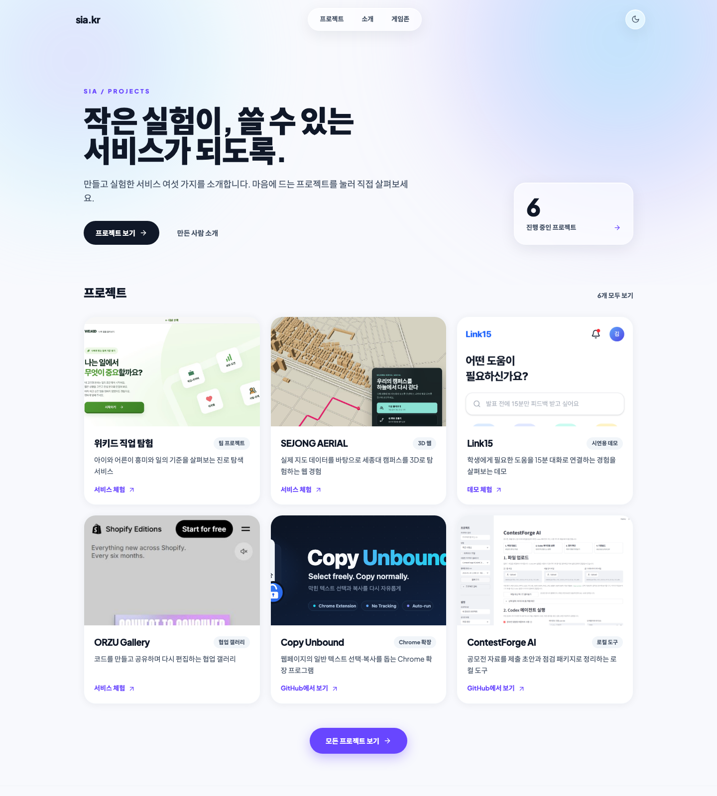

<div align="center">

# sia.kr

**만든 서비스를 발견하고 바로 체험할 수 있는 프로젝트 허브**

<a href="https://sia.kr">🌐 sia.kr</a> · <a href="https://sia.kr/projects">Projects</a> · <a href="https://sia.kr/gamezone">Game Zone</a>



</div>

<br>

## ✨ 소개

`sia.kr`은 제가 만든 프로젝트들을 모아 소개하고 바로 이동시키는 허브입니다.
첫 화면에서 대표 프로젝트 6개가 한눈에 보이고, 관심 있는 서비스로 한 번에 이동할 수 있습니다.

디자인은 밝은 펄 화이트 위에 오로라 그라데이션, 내비게이션에 글래스(유리) 효과를 적용한
**Aurora / Glass** 스타일이며, 라이트·다크 모드를 모두 지원합니다.

## 🚀 소개 프로젝트

| 프로젝트 | 소개 | 분류 | 링크 |
| --- | --- | --- | --- |
| 🧭 **위키드 직업 탐험** | 아이와 어른이 흥미와 일의 기준을 살펴보는 진로 탐색 | 팀 프로젝트 | [서비스 체험](https://wekid-black.vercel.app/) |
| �️ **SEJONG AERIAL** | 실제 지도 데이터 기반 세종대 캠퍼스 3D 탐험 | 3D 웹 | [서비스 체험](https://sejong-aerial.vercel.app/) |
| ⏱️ **Link15** | 필요한 도움을 15분 대화로 연결하는 경험 | 시연용 데모 | [데모 체험](https://saitgak.vercel.app/) |
| 🖼️ **ORZU Gallery** | 코드를 만들고 공유하며 다시 편집하는 협업 갤러리 | 협업 갤러리 | [서비스 체험](https://orzu-gallery.vercel.app/) |
| � **Copy Unbound** | 막힌 텍스트 선택·복사를 되살리는 Chrome 확장 | Chrome 확장 | [GitHub](https://github.com/koreadeveloper/Copy-Unbound) |
| � **ContestForge AI** | 공모전 자료를 제출 초안과 점검 패키지로 정리 | 로컬 도구 | [GitHub](https://github.com/koreadeveloper/Contestforge) |

## �️ 사이트 구조

| 경로 | 내용 |
| --- | --- |
| `/` | 히어로 + 대표 프로젝트 6개 |
| `/projects` | 전체 프로젝트 목록 |
| `/about` | 제작자 소개·프로젝트별 역할 |
| `/gamezone` | 30+ 브라우저 게임 (체스·장기·고스톱·포커 등) |

## 🛠️ 기술 스택

- **React 19** + **TypeScript** + **Vite**
- **Tailwind CSS** (CDN, 커스텀 디자인 토큰)
- **React Router** — SPA 라우팅
- **Supabase** — 게임존 점수/랭킹 (선택적, 키 없이도 실행 가능)
- **Stockfish 19 (WASM)** · **three** · **chess.js** — 게임존 엔진

## � 시작하기

```bash
npm install
npm run dev        # http://localhost:3000
npm run build      # 프로덕션 빌드 (dist/)
```

게임존 점수 저장까지 사용하려면 `.env.local`에 Supabase 키를 넣으세요
(없어도 사이트는 정상 동작하고 점수 저장만 비활성화됩니다).

```env
VITE_SUPABASE_URL=...
VITE_SUPABASE_ANON_KEY=...
```

## ✏️ 콘텐츠 관리

프로젝트 카드와 사이트 문구는 데이터 파일 하나로 관리합니다.

- **`data/projects.ts`** — 프로젝트 목록. 메인에는 `featuredRank` 1~6만 노출.
  새 프로젝트 추가 시 기존 항목은 유지하고 순위만 조정하면 됩니다.
- **`data/site.ts`** — 사이트 이름, 히어로 문구, GitHub 링크 등.
- **`public/projects/`** — 카드 이미지.

## � 배포

Vercel 기준 (`vercel.json` 포함). SPA 라우팅 지원을 위해 빌드 시
`index.html`이 `404.html`로 복사되어 GitHub Pages류 정적 호스팅에서도
직접 경로 접근이 동작합니다.

<div align="center">

<sub>© 2026 sia.kr — made with 💜</sub>

</div>
